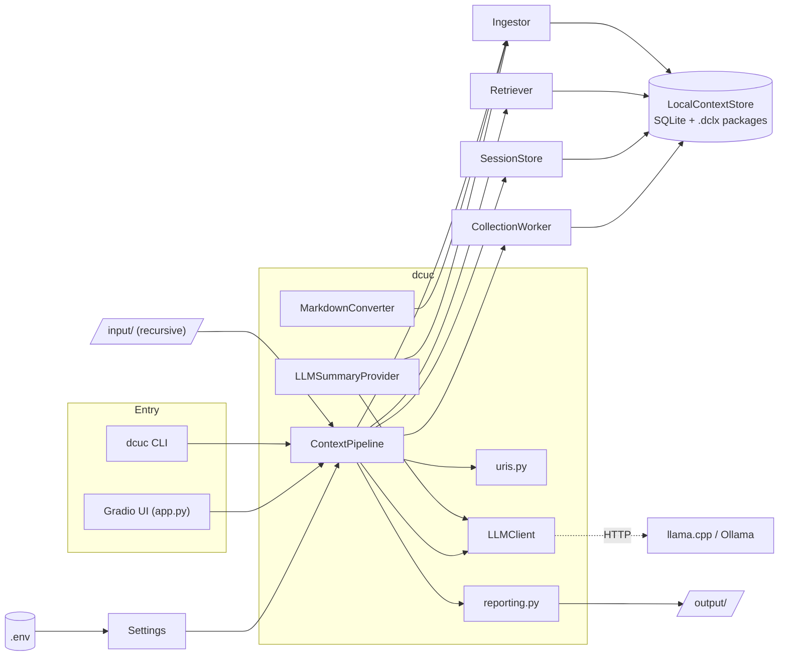
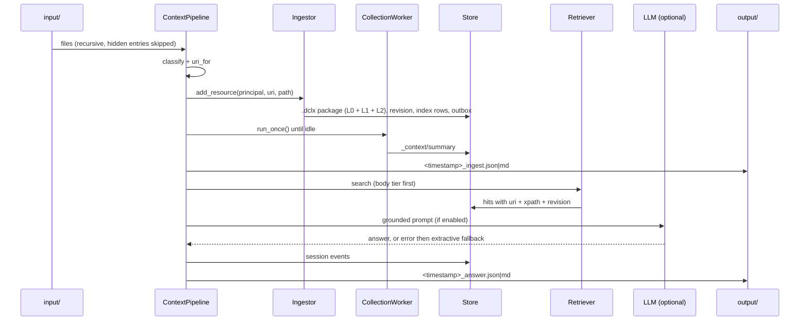

# Implementation Guide: docling-context sample (`dcuc`)

This guide describes how the sample application is built, configured, run and
verified. Everything here was checked against the code and the test runs in this
repository. Where behaviour differs from what you might assume (for example, logging
does **not** rotate), the text says so explicitly.

Related documents: [`README.md`](../README.md), [`Quickstart.md`](Quickstart.md),
[`Architecture.md`](Architecture.md).

---

## Table of contents

1. [Project overview and architecture](#1-project-overview-and-architecture)
2. [Setup and installation](#2-setup-and-installation)
3. [Core implementation details](#3-core-implementation-details)
4. [Configuration and runtime](#4-configuration-and-runtime)
5. [Testing and quality assurance](#5-testing-and-quality-assurance)
6. [CLI and UI features](#6-cli-and-ui-features)
7. [Known limitations and fallback behaviours](#7-known-limitations-and-fallback-behaviours)
8. [Validation results](#8-validation-results)
9. [Maintenance checklist](#9-maintenance-checklist)

---

## 1. Project overview and architecture

### 1.1 Purpose

`dcuc` shows how to build a local application on
[docling-context](https://github.com/docling-project/docling-context). It ingests a folder
of documents into a tiered store, searches it with exact citations, answers questions
through a local LLM (with an extractive fallback) and records conversations in sessions.
No cloud service is needed.

### 1.2 Components and interactions



| Component | File | Responsibility |
|-----------|------|----------------|
| Settings | [`dcuc/config.py`](../dcuc/config.py) | Immutable, validated configuration. |
| URI mapping | [`dcuc/uris.py`](../dcuc/uris.py) | Path to `docling://` URI, file classification, slug and hash suffix. |
| Converter | [`dcuc/converters.py`](../dcuc/converters.py) | Markdown and text to DocLang (library `Converter` protocol). |
| LLM client | [`dcuc/llm.py`](../dcuc/llm.py) | OpenAI-compatible `/chat/completions` client. |
| Summaries | [`dcuc/summaries.py`](../dcuc/summaries.py) | LLM-written L0 summary (library `SummaryProvider` protocol). |
| Facade | [`dcuc/pipeline.py`](../dcuc/pipeline.py) | Ingest, jobs, tree, search, ask, sessions. |
| Reports | [`dcuc/reporting.py`](../dcuc/reporting.py) | Atomic, timestamped JSON and Markdown output. |
| CLI | [`dcuc/cli.py`](../dcuc/cli.py) | `dcuc` command and exit codes. |
| UI | [`app.py`](../app.py) | Gradio app and signal handlers. |

### 1.3 Data flow, input to output



### 1.4 Technology stack

| Concern | Choice |
|---------|--------|
| Language | Python 3.13 (`.python-version`) |
| Package management | `uv` with `uv.lock`, hatch build backend |
| Core library | `docling-context` and `doclang` (pinned git commits in `[tool.uv.sources]`) |
| UI | Gradio 6.x (local, no cloud) |
| HTTP | `httpx` |
| Configuration | `python-dotenv` |
| Storage | SQLite plus content-addressed `.dclx` packages |
| Optional extras | `conversion` (Docling for PDF and Office), `vectors` (embeddings) |
| Dev tools | pytest, pytest-cov, ruff |

---

## 2. Setup and installation

### 2.1 Prerequisites

| Requirement | Notes |
|-------------|-------|
| macOS or Linux with bash | The scripts use bash, `curl`, `rsync` and `pgrep`. |
| `uv` | https://docs.astral.sh/uv/ |
| `git` | `uv` installs docling-context and DocLang from git. |
| Optional LLM | llama.cpp (`http://localhost:9931/v1`) or Ollama. Not required. |

### 2.2 Steps

```bash
cd docling-context-uc
cp .env.example .env     # optional: the scripts create it if it is missing
uv sync                  # creates .venv from pyproject.toml + uv.lock
scripts/load-samples.sh  # copy samples/ into input/ (never overwrites)
scripts/demo.sh          # CLI demo
scripts/start.sh         # UI in detached mode, prints the URL
```

### 2.3 Dependency management

- `ensure_env()` in [`scripts/_common.sh`](../scripts/_common.sh) runs `uv sync` and adds
  `--extra conversion` / `--extra vectors` when `DC_ENABLE_CONVERSION=true` or
  `DC_ENABLE_VECTORS=true` in `.env`.
- Re-run `uv sync` (or any script) after changing `pyproject.toml`, so the virtual
  environment matches.
- `doclang` is a **direct** dependency because the app imports it.
- The upstream sources are pinned to exact commits: docling-context `58b2048`, DocLang
  `92d2990`. Change the pins deliberately and re-run the tests.

---

## 3. Core implementation details

### 3.1 Logging architecture

[`configure_logging`](../dcuc/logging_setup.py:11) sets up the root logger once and can be
called repeatedly (`force=True`):

```python
handlers = [logging.StreamHandler()]                       # always: console (stderr)
if log_file is not None:                                   # optional
    log_file.parent.mkdir(parents=True, exist_ok=True)
    handlers.append(logging.FileHandler(log_file, encoding="utf-8"))
logging.basicConfig(level=..., format=_FORMAT, handlers=handlers, force=True)
for noisy in ("httpx", "httpcore", "gradio", "urllib3"):   # keep our own logs readable
    logging.getLogger(noisy).setLevel(logging.WARNING)
```

Precise behaviour, which differs from common assumptions:

| Topic | Behaviour |
|-------|-----------|
| Format | `%(asctime)s %(levelname)-7s %(name)s: %(message)s` |
| Console | Always on (`StreamHandler`, stderr). |
| File handler | A plain `logging.FileHandler` (UTF-8, append mode). **There is no rotation, size cap or retention.** |
| Who passes `log_file` | **Nobody.** Both [`cli.py`](../dcuc/cli.py:140) and [`app.py`](../app.py:169) call `configure_logging(settings.log_level)` only. |
| Where `logs/app.log` comes from | [`scripts/start.sh`](../scripts/start.sh) starts the app with `>>logs/app.log 2>&1`, so the console stream is appended to that file. |
| Growth | The file grows without limit. `scripts/cleanup.sh` deletes `logs/`. For long-running use, add `logging.handlers.RotatingFileHandler` in `configure_logging`, or use `logrotate`. |
| Sensitive data | `LLMSettings.api_key` is declared with `repr=False`, so it is not printed in logs or tracebacks. LLM errors log only the exception class name. |

### 3.2 Slugs and the hash suffix

[`slug()`](../dcuc/uris.py:32) makes each URI path segment safe:

```python
result = re.sub(r"[^\w.-]+", "-", value, flags=re.UNICODE).strip(".-")
if not result:
    raise ValueError(...)
if result != value:                                   # the name had to change
    result += "-" + hashlib.sha256(value.encode("utf-8")).hexdigest()[:8]
```

- **Trigger:** the suffix is added whenever slugging **changes** the name: a character
  was replaced, or leading or trailing `.` or `-` was stripped. It is **not** collision
  detection. The code never compares against other URIs.
- **Suffix:** the first 8 hex digits of the SHA-256 of the **original** segment.
- **Why it prevents collisions:** a changed name always carries a hash of its original
  text, so `a b` becomes `a-b-<hash of "a b">` and can never equal an untouched `a-b`.
  A name that is already clean passes through unchanged.
- **Scope:** applied to every directory segment and to the file stem. The stem is
  computed first by [`strip_suffix`](../dcuc/uris.py:54), which handles double
  extensions such as `.dclg.xml`.
- **Case:** case is preserved (`\w` includes upper case), so `Report.md` and `report.md`
  are different clean names. Be aware of this on case-insensitive file systems.
- **Determinism:** the same input always yields the same URI, so re-ingesting updates
  the same resource.

| Input file | URI |
|------------|-----|
| `engineering/incident-severity.md` | `docling://resources/knowledge/engineering/incident-severity` |
| `policies/support hours.txt` | `docling://resources/knowledge/policies/support-hours-144e0bdf` |
| `policies/refund-policy.dclg.xml` | `docling://resources/knowledge/policies/refund-policy` |

[`uri_for`](../dcuc/uris.py:75) finishes by validating the URI with the library's
`parse_uri`. It uses `os.path.abspath` and does **not** resolve symlinks. Symlink
resolution is left to the Ingestor's `allowed_roots` check, which is the single security
boundary for file reads.

### 3.3 LLM endpoint routing rules

[`validate_endpoint`](../dcuc/llm.py:31) decides whether a base URL is accepted:

| Scheme | Host | Result |
|--------|------|--------|
| `https` | any non-empty host | **Allowed** |
| `http` | `localhost`, `127.0.0.1`, `::1` | **Allowed** |
| `http` | anything else | `LLMError` |
| other scheme or no host | | `LLMError` |

Error text: `LLM_BASE_URL must be HTTPS or loopback HTTP (e.g. http://localhost:9931/v1)`.

Other client rules:

- `follow_redirects=False`, so a redirect cannot move traffic to another host.
- The timeout comes from `LLM_TIMEOUT_SECONDS` (1 to 600).
- Every failure becomes `LLMError`, so callers can fall back:

| Condition | `LLMError` message |
|-----------|--------------------|
| Network or timeout error | `LLM request failed: <ExceptionClass>` |
| Non-200 status | `LLM returned HTTP <code>` |
| Body over 2,000,000 bytes | `LLM response is too large` |
| Not an OpenAI-style completion | `LLM response is not an OpenAI-style chat completion` |
| Empty text | `LLM returned an empty answer` |
| `LLM_BASE_URL` empty | `LLM is disabled (LLM_BASE_URL is empty)` |

- The size limit is checked **after** `httpx` has read the body, so it protects the
  parser and the prompt, not memory. Use a streaming read if you need a hard memory bound.
- An invalid URL at start-up does not stop the app. `ContextPipeline._make_llm` logs
  `LLM disabled: ...` and continues without an LLM.
- `LLMClient.ping()` checks `/models` with a 3 second timeout and never raises.

### 3.4 Sessions and idempotency keys

`SessionStore` comes from the library. The app uses it as follows
([`_record_turn`](../dcuc/pipeline.py:502)):

```python
turn = uuid.uuid4().hex
self.sessions.append(principal, session_id, key=f"{turn}-q", kind="turn",
                     turn_id=turn, text=f"user: {question}"[:20_000])
self.sessions.append(principal, session_id, key=f"{turn}-a", kind="turn",
                     turn_id=turn, text=f"assistant ({method}): {answer}\nsources: ...")
```

- Each `ask()` produces **one new random `turn` ID** and two events: `<turn>-q` and
  `<turn>-a`. The two events share a `turn_id`.
- The keys are **unique per turn**. The library treats a re-sent identical key as a
  no-op, which protects against duplicate delivery of the *same* event. It does **not**
  deduplicate two separate `ask()` calls with the same question, because each gets a
  fresh key. If you need request-level idempotency (for example, an HTTP retry),
  derive `turn` from a client-supplied request ID instead of `uuid4()`.
- Text is cut at 20,000 characters.
- Valid `kind` values in the library: `turn`, `tool_call`, `tool_result`, `feedback`.
- A closed session raises `ValueError`.
- Session URIs have the form `docling://users/{tenant}/{user}/sessions/{id}`.
- In the UI, the Ask tab keeps the session ID in Gradio state. **New session** clears it.
  The CLI creates a session per `ask` unless `--session` is given.
- All session calls take the pipeline `RLock`.

### 3.5 Upload mechanism and blob storage

**Upload path (UI):**

1. The Ingest tab's file control gives Gradio temporary file paths.
2. [`do_upload`](../app.py:51) reads each file with `path.read_bytes()` and calls
   `pipeline.ingest_bytes(data, filename)`.
3. [`ingest_bytes`](../dcuc/pipeline.py:325) classifies by file name, picks the
   converter and builds the URI against a virtual root:
   `docling://resources/<collection>/uploads/<slug>`. Only `Path(filename).name` is
   used, so no directory components are accepted from the client.
4. It creates an `Ingestor` **without** `allowed_roots`, because it passes bytes and
   never opens a path on behalf of the caller. The library documents this separation:
   path ingestion requires `allowed_roots`, byte ingestion does not.
5. `origin_uri` is set to `upload:<name>`. After the write, collection jobs are processed.
6. Errors (`PackageError`, `ValueError`, `RuntimeError`) become a `failed` outcome. An
   unsupported type becomes `skipped`.

**Blob storage (library):**

```
context-data/
├── context.sqlite3                  # metadata, revisions, FTS index, outbox, jobs, sessions
└── packages/<aa>/<sha256>.dclx      # content-addressed package, one per revision
```

- Each `.dclx` package holds `document.xml` (L2), a summary (L0), a TOC (L1) and a
  `context/manifest.json`. The file name is the package SHA-256, and `<aa>` is its first
  two hex digits.
- Blob reads verify the hash. On open, `LocalContextStore` reconciles packages: a blob
  that is missing or fails its check is marked unavailable.
- A logical URI always points to the latest revision. Older revisions stay addressable
  by document ID, revision ID and XPath.
- Re-ingesting an unchanged file returns the existing record, because the source
  fingerprint matches. `FileOutcome.status` is `unchanged` when the revision ID did not
  change.
- Uploaded content is stored in the same store and is not written into `input/`.

### 3.6 UI signal handlers

In [`app.py`](../app.py:164) `main()`:

```python
def shutdown(signum, _frame):
    if stopped.is_set():           # idempotent: ignore repeated signals
        return
    stopped.set()
    log.info("Received signal %s - shutting down gracefully", signum)
    try:
        ui.close()                 # stop accepting requests
    finally:
        pipeline.close()           # close LLM client, then the SQLite store
    sys.exit(0)

signal.signal(signal.SIGTERM, shutdown)
signal.signal(signal.SIGINT, shutdown)
ui.queue(default_concurrency_limit=4).launch(server_name=host, server_port=port,
                                             share=False, prevent_thread_lock=False)
```

- The `finally` after `launch()` closes the pipeline on normal exit when no signal
  handler ran.
- `share=False` and the default host `127.0.0.1` keep the app local.
- Concurrency is limited to 4 and store access is serialised by the pipeline `RLock`.
- The signal handler body (lines 164 to 198) is not covered by unit tests. It was
  verified by running `scripts/start.sh` and `scripts/stop.sh`, which logged a graceful
  stop (see section 8).

### 3.7 Question answering

1. [`keyword_query`](../dcuc/pipeline.py:130) removes stop words, and keeps the original
   text when nothing is left.
2. [`_answer_context`](../dcuc/pipeline.py:459) searches tier 2 (body) first, then
   tiers 0, 1 and 2 together. It over-fetches (`min(3k, 50)`), drops
   `_context/summary` and removes duplicates.
3. [`_compose_answer`](../dcuc/pipeline.py:483) calls the LLM with numbered passages. On
   `LLMError` it logs a warning and returns `Most relevant passages:` plus the top three
   passages (`method = "extractive"`).
4. A query with no word characters returns `Cannot search: ...` instead of raising.
5. The library's lexical search tries an AND match first, then OR.

---

## 4. Configuration and runtime

### 4.1 Environment variables

Loaded by [`Settings.from_env`](../dcuc/config.py:79). `.env` is read first but **never
overrides** variables already exported in the shell. All names are in
[`.env.example`](../.env.example).

| Variable | Default | Validation |
|----------|---------|------------|
| `DC_TENANT_ID`, `DC_USER_ID` | `demo`, `local` | Validated by the library's `Principal` (no `/`, `%`, `..`, control characters). |
| `DC_INPUT_DIR` | `./input` | Must exist when ingesting. |
| `DC_OUTPUT_DIR` | `./output` | Created if missing. |
| `DC_STORE_DIR` | `./context-data` | Created by the library. |
| `DC_COLLECTION` | `knowledge` | `^[a-z0-9][a-z0-9_-]{0,63}$`. |
| `DC_ENABLE_CONVERSION` | `false` | Strict boolean. |
| `DC_ENABLE_VECTORS` | `false` | Strict boolean. |
| `DC_EMBEDDING_MODEL` | `BAAI/bge-small-en-v1.5` | None. |
| `LLM_BASE_URL` | `http://localhost:9931/v1` | Empty disables the LLM. See 3.3. |
| `LLM_MODEL` | `local-model` | None. |
| `LLM_API_KEY` | empty | Not shown in `repr`. |
| `LLM_TIMEOUT_SECONDS` | `60` | Integer 1 to 600. |
| `LLM_SUMMARIES` | `false` | Strict boolean. |
| `APP_HOST` | `127.0.0.1` | None. |
| `APP_PORT` | `7860` | Integer 1024 to 65535, and not 5000. |
| `LOG_LEVEL` | `INFO` | Unknown names fall back to INFO. |

Booleans accept `1/true/yes/on` and `0/false/no/off/<empty>`. Anything else raises
`ValueError`, so typos fail fast.

### 4.2 Native suffix handling

[`classify`](../dcuc/uris.py:63) uses the lower-cased file name:

| Class | Suffixes | Handling |
|-------|----------|----------|
| `native` | `.dclg.xml`, `.dclg`, `.dclx` | Passed to the Ingestor unchanged. No converter. |
| `text` | `.md`, `.markdown`, `.txt` | `MarkdownConverter` (built in). |
| `docling` | `.pdf .docx .pptx .xlsx .html .htm .png .jpg .jpeg .tif .tiff .bmp .webp .csv .asciidoc .adoc` | Docling, only when `DC_ENABLE_CONVERSION=true` (OCR off by default). |
| none | everything else | `skipped: unsupported file type` |

Matching is by suffix order: native, then text, then Docling. Hidden files and folders
(any path part starting with `.`) are skipped during the walk. A run is refused above
`MAX_FILES_PER_RUN = 10_000`.

### 4.3 Error message specification

| Source | Message or behaviour | Exit code |
|--------|----------------------|-----------|
| Invalid setting | `Configuration error: <detail>` on stderr | `2` |
| Port 5000 | `APP_PORT 5000 is reserved on macOS; choose another port` | `2` |
| Bad boolean | `<NAME> must be a boolean (true/false), got '<value>'` | `2` |
| Bad integer | `<NAME> must be an integer, got ...` or `must be between L and H, got N` | `2` |
| Bad collection | `collection must be 1-64 chars of lowercase letters, digits, '-' or '_'` | `2` |
| Invalid or unauthorised URI | Logged as `Invalid or unauthorised URI: ...` | `2` |
| Unknown document | Logged as `Not found: ...` | `1` |
| Missing input folder | `input directory does not exist: <path>` | `1` |
| Too many files | `refusing to ingest N files (> 10000)` | `1` |
| Any file failed during `ingest` | Report shows `failed` rows | `1` |
| Ctrl-C | `Interrupted` | `130` |
| Success (including `demo` with a failed sample) | | `0` |

Per-file ingest failures are reported with the library's message, for example
`could not parse DocLang XML: Start-end tags mismatch at offset 123`.

### 4.4 Scripts: start and stop

| Script | Behaviour |
|--------|-----------|
| `scripts/start.sh` | If already running, prints the PID. Otherwise it runs `ensure_env`, creates `.run/ logs/ input/ output/`, starts `nohup uv run --no-sync python app.py >>logs/app.log 2>&1 &` and writes the PID to `.run/app.pid`. It then polls the URL for up to 60 seconds and prints `docling-context sample is running: http://HOST:PORT`. If the process dies during start-up, it prints the last 20 log lines and exits 1. |
| `scripts/stop.sh` | If not running, prints `Not running.` and removes a stale PID file. Otherwise it collects the child processes (`uv run` spawns Python as a child), sends **SIGTERM** to the children and the parent, and waits up to 15 seconds. On success it prints `Stopped gracefully.`. After 15 seconds it prints a warning and sends **SIGKILL**. |
| `scripts/demo.sh` | `ensure_env`, `load-samples.sh`, `dcuc demo`, `dcuc tree`. |
| `scripts/test.sh` | `uv sync`, `ruff check dcuc tests app.py`, `pytest --cov`. |
| `scripts/load-samples.sh` | `rsync -a --ignore-existing samples/ input/`. |
| `scripts/cleanup.sh [--all]` | Stops the app, removes `node_modules`, `.venv`, `__pycache__`, `.pytest_cache`, `.ruff_cache`, `.gradio`, `.coverage`, `htmlcov`, `.run` and `logs`. With `--all` it also removes `context-data/` and the contents of `input/` and `output/` (keeping `.gitkeep`). |

All scripts are executable (`chmod +x`). `start.sh` and `stop.sh` use the PID file, so
they work from any directory. Note that `env_value` reads `.env` with `grep` and never
executes it.

---

## 5. Testing and quality assurance

### 5.1 Suite overview

83 tests (collected with `pytest --co`):

| File | Tests | Covers |
|------|-------|--------|
| `test_uris.py` | 21 | Slugs, hash suffix, classification, suffix stripping, collection validation. |
| `test_pipeline.py` | 20 | Recursive ingest, idempotency and forced revisions, changed files, hidden and unsupported files, symlink escape, missing input folder, scoped search and citations, overview, tree, ask (extractive, no hits, LLM, LLM failure), LLM summaries, uploads, tenant isolation, persistence across restarts, keyword query, body-first context. |
| `test_llm.py` | 16 | Allowed and rejected endpoints, request payload and auth header, bad responses, network errors, and the summary provider (bounded text, escaped output, empty documents). |
| `test_converters.py` | 9 | Markdown parsing and DocLang output. |
| `test_config.py` | 8 | Booleans, integers, port 5000, collection checks. |
| `test_cli.py` | 4 | Commands and exit codes. |
| `test_reporting.py` | 3 | Atomic timestamped reports. |
| `test_app.py` | 2 | UI construction with its handlers, and the upload handler. |

Design: temporary stores, the **real** docling-context library, and a fake LLM via
`httpx.MockTransport` (fixture `fake_llm` in `conftest.py`). No network is needed.

### 5.2 Lint and syntax validation

```bash
uv run ruff check dcuc tests app.py       # lint (scripts/test.sh runs this first)
for f in scripts/*.sh; do bash -n "$f"; done   # shell syntax check
uv run pytest --cov=dcuc --cov=app --cov-report=term-missing
```

### 5.3 `.gitignore` compliance

Each rule below was checked with `git check-ignore` in a scratch repository using this
`.gitignore`:

| Rule from the project requirements | Result |
|------------------------------------|--------|
| `.env` and `.env.*` ignored, `.env.example` kept | `.env`, `.env.local` ignored. `.env.example` tracked. |
| Folders starting with `_` ignored | `_sources/`, `_docs/` ignored. |
| `*.onnx`, `*.onnx.data`, `*.so`, `*.tgz`, `*.tar.gz`, `*.zip`, `*.dylib` | All ignored. |
| `node_modules/` | Ignored. |
| `.playwright-mcp/` | Ignored. |
| `input/` and `output/` tracked, contents ignored | `.gitkeep` tracked. Other files ignored. |
| `AGENTS.md` and `.bob/mcp.json` | Ignored. |
| Source and docs | `README.md` tracked. |

The runtime folders `context-data/`, `logs/`, `.run/`, `.venv/` and `.gradio/` are also
ignored.

---

## 6. CLI and UI features

### 6.1 CLI

```bash
uv run dcuc [--env-file F] [--store DIR] [--collection NAME] [--no-llm] <command>
  ingest [--input DIR] [--force]
  search QUERY [-k N] [--mode auto|lexical|vector|hybrid] [--uri URI]
  ask QUERY [-k N] [--session ID]
  tree [-L DEPTH]
  show URI
  status
  demo [--input DIR]
```

`demo` ingests the folder, starts a session and asks two questions ("How do I rotate the
API credentials?" and "What is the refund policy?"). It prints the session transcript
length (4 events for two turns).

**Timestamped reports.** Each command writes to `output/`:

| Command | Files |
|---------|-------|
| `ingest`, `demo` | `YYYYMMDD-HHMMSS_ingest.json` and `.md` |
| `ask`, `demo` | `YYYYMMDD-HHMMSS_answer.json` and `.md` |
| `search` | `YYYYMMDD-HHMMSS_search.json` and `.md` |

Reports are written to a temporary file in the same folder and then moved into place
with `os.replace`, so a partial file never appears. Two reports of the same kind in the
same second share a name, so the second overwrites the first. The UI Ask tab also writes
an answer report for each question.

### 6.2 Gradio tabs

| Tab | Interaction |
|-----|-------------|
| Status | JSON of store statistics (documents, indexed nodes, embedded nodes, summary staleness, LLM and vector flags). **Refresh** reloads. |
| Ingest | **Ingest input folder** (with a *force* option and a progress bar), or upload files. Shows a per-file table and saves a report. |
| Search | Query, `k` (1 to 20), mode, and tier checkboxes (summary, toc, body). Returns a table of score, tier, URI, XPath and text. |
| Ask | Chat plus session. Each reply lists the method (`llm` or `extractive`) and numbered sources. **New session** starts a fresh session. |
| Explore | Context tree and a document picker. Shows the L0 summary, the L1 TOC, and revision and provenance JSON. |

### 6.3 Output and artifact folders

```
output/                      # runtime results, timestamped; content git-ignored
.bob/artifacts/              # project artifacts kept with the repository
├── PROJECT_SUMMARY.md
├── IMPLEMENTATION_GUIDE.md  # copy of this document
├── test-results.txt
├── sample-ingest-report.md
└── sample-answer-report.md
```

---

## 7. Known limitations and fallback behaviours

| Situation | Behaviour |
|-----------|-----------|
| Local LLM not running (connection refused) | `LLMError` is raised, `LLM answer failed, falling back to extractive` is logged, and the answer quotes the top three passages with `method = extractive`. Verified in the UI and CLI. |
| LLM times out | The same fallback. The wait is `LLM_TIMEOUT_SECONDS` per request, so set `LLM_BASE_URL=` empty to skip the wait when no LLM runs. |
| LLM summaries fail | The library records `summary_method = extractive-fallback`. Ingest continues. |
| `LLM_BASE_URL` invalid | The pipeline logs `LLM disabled: ...` and runs without an LLM. |
| Vector extra missing or model cannot load | `Vector search disabled (...); using lexical search`. |
| Docling extra missing | Docling-class files are `skipped` with a message that explains how to enable conversion. |
| One file fails | That file is `failed`. The rest continue. `dcuc ingest` then exits 1. |
| `status()` on a never-written collection | The library returns `None`. The app handles this. |
| Store start-up fails | The SQLite connection is closed before the error is raised. |

Limitations to be aware of:

- **Logging has no rotation** (section 3.1).
- **Idempotency keys are per turn**, not per request (section 3.4).
- **Concurrency:** `LocalContextStore` uses one SQLite connection and is not thread-safe,
  so the pipeline serialises access with an `RLock`. This is correct for a single local
  user. It is not a multi-user server design.
- **Case sensitivity:** URIs preserve case (section 3.2).
- **Report names** have one-second resolution.
- **LLM response size** is checked after the body is read (section 3.3).
- **Lexical retrieval** is the default. Meaning-based matches need `DC_ENABLE_VECTORS=true`.
- **Gradio and Starlette** may log `HTTP_422 deprecated` warnings. They are harmless.
- **No container image** is built or pulled. If you add one, use a multi-stage
  `Containerfile` with Podman and add an image-removal script.

---

## 8. Validation results

Run on 2026-10-12 (macOS, Python 3.13.9, Gradio 6.17) against the current working tree,
after the external edits to the docs, scripts, tests and several modules.

### 8.1 Tests and coverage

| Check | Result |
|-------|--------|
| `ruff check dcuc tests app.py` | All checks passed |
| `pytest` | 83 passed, 0 failed |
| Total coverage | **92%** (884 statements, 72 missed) |
| Shell syntax (`bash -n scripts/*.sh`) | No errors; all scripts executable |

| Module | Coverage | Not covered |
|--------|----------|-------------|
| `dcuc/__init__.py`, `summaries.py`, `uris.py` | 100% | |
| `dcuc/converters.py` | 99% | line 148 |
| `dcuc/config.py` | 98% | line 29 |
| `dcuc/llm.py` | 94% | lines 62, 65, 84 |
| `dcuc/cli.py` | 93% | `KeyboardInterrupt` and a few branches |
| `dcuc/pipeline.py` | 93% | optional vector and Docling paths |
| `dcuc/reporting.py` | 92% | atomic-write error cleanup |
| `dcuc/logging_setup.py` | 83% | the `log_file` branch (nobody passes it) |
| `app.py` | 76% | `main()` and signal handlers |

### 8.2 Build verification checklist

- [x] `uv sync` creates the environment; `uv.lock` present
- [x] `ruff` clean
- [x] 83 tests pass
- [x] CLI `demo` ingests 4 files, reports 1 intentional failure, answers 2 questions
- [x] `scripts/start.sh` prints `http://127.0.0.1:7860`
- [x] UI Status, Ingest, Search, Ask and Explore tabs checked in Chrome
- [x] Ask returns an extractive answer with a citation (LLM off)
- [x] Search returns tiered hits with URI and XPath
- [x] `scripts/stop.sh` reports `Stopped gracefully.`
- [x] `.gitignore` rules verified (section 5.3)
- [x] README has architecture and workflow diagrams and the MIT licence
- [x] `Docs/Quickstart.md` and `Docs/Architecture.md` present
- [x] No secrets in code; `.env.example` provided
- [ ] LLM-backed answers against a live local server (not available during testing)
- [ ] Vector and Docling extras (optional, not exercised)

### 8.3 Performance notes

Measured on the 5-file sample corpus with `--no-llm`, using a fresh store:

| Operation | Result |
|-----------|--------|
| First ingest, plus 2 questions (`demo`) | 0.02 s ingest, 0.21 s wall time including start-up |
| Second `ingest` (4 unchanged, 1 failed) | 0.002 s ingest, 0.16 s wall time |

These show that fingerprint checks make repeat ingestion nearly free. The sample is
small; measure with your own corpus. With an LLM, answer time is dominated by the
model, and a missing LLM adds up to `LLM_TIMEOUT_SECONDS` per call if the connection
hangs rather than being refused.

---

## 9. Maintenance checklist

1. After changing `pyproject.toml`, run `uv sync`. After changing `.env.example`, update
   the table in section 4.1 and the README.
2. Before merging: `scripts/test.sh` and `for f in scripts/*.sh; do bash -n "$f"; done`.
3. When bumping the docling-context or DocLang pins, re-run the tests and check that
   `Ingestor`, `Retriever`, `SessionStore` and `CollectionWorker` signatures still match.
4. Keep any new document in `Docs/`, and update the existing documents instead of
   adding duplicates.
5. If you add file logging, wire `log_file` in `cli.py` and `app.py`, use a rotating
   handler, and update section 3.1.
6. At the end of the project, run `scripts/cleanup.sh`.
