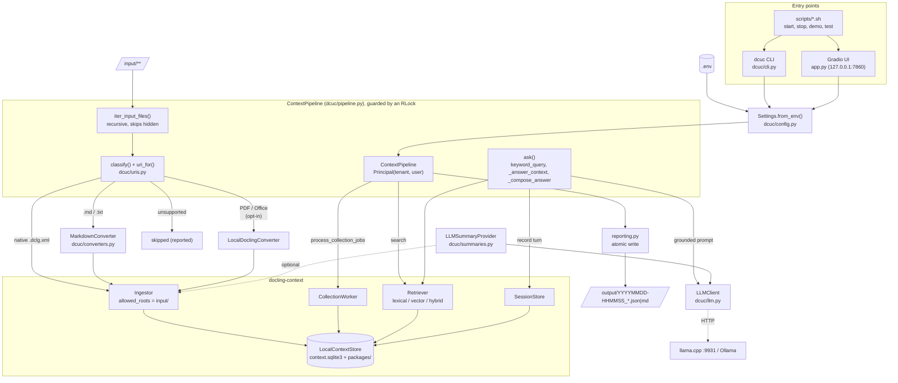
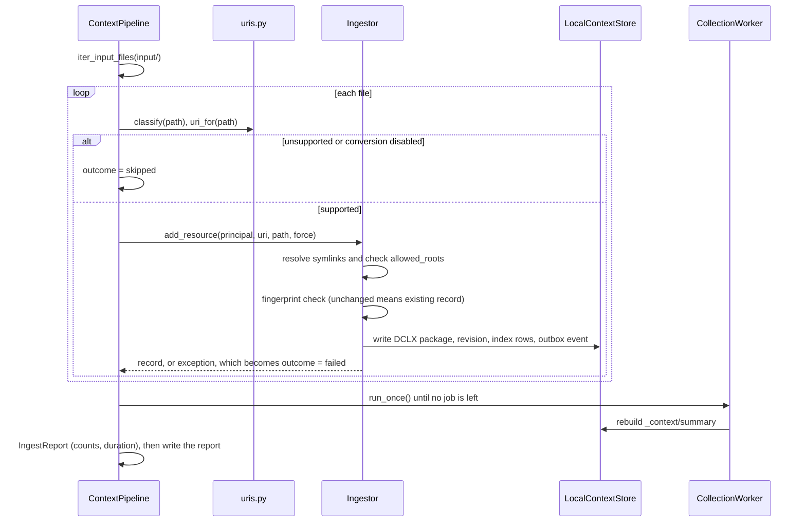

# Architecture

This document describes how the sample application (`dcuc`) is built on top of
[docling-context](https://github.com/docling-project/docling-context): its components,
the data model, the main flows, and the security and resource-management decisions.

## 1. Flow architecture

## 2. Components

| Component | Layer | Role |
|-----------|-------|------|
| [`Settings`](../dcuc/config.py) | Configuration | Immutable dataclass loaded from `.env` and the environment, validated at start-up. Invalid values fail fast with exit code `2`. |
| [`ContextPipeline`](../dcuc/pipeline.py) | Application facade | Owns one `LocalContextStore` and the library services. Exposes `ingest_directory`, `ingest_bytes`, `process_collection_jobs`, `tree`, `status`, `document_overview`, `search`, `ask` and the session helpers. |
| [`MarkdownConverter`](../dcuc/converters.py) | Integration (library protocol) | Implements `Converter`: turns Markdown and text into DocLang `<heading level>` and `<text>` elements. |
| [`LLMSummaryProvider`](../dcuc/summaries.py) | Integration (library protocol) | Implements `SummaryProvider`: asks the local LLM for an L0 summary. |
| [`LLMClient`](../dcuc/llm.py) | Integration (HTTP) | OpenAI-compatible `chat/completions` client built on `httpx`. |
| [`reporting`](../dcuc/reporting.py) | Output | Writes timestamped JSON and Markdown reports to `output/`. |
| [`cli`](../dcuc/cli.py) / [`app`](../app.py) | Presentation | Thin layers over the pipeline. They hold no business logic. |

The facade pattern keeps the CLI, the UI and the tests on exactly the same code
path. Each entry point only parses input and formats output.

## 3. Data model

### URIs

| Kind | Form | Example |
|------|------|---------|
| Resource | `docling://resources/{collection}/{path}` | `docling://resources/knowledge/engineering/runbooks/credential-rotation` |
| Collection summary | `docling://resources/{collection}/_context/summary` | Generated by `CollectionWorker` |
| Session | `docling://users/{tenant}/{user}/sessions/{id}` | Created by `SessionStore.start` |

`uri_for()` maps `input/<dirs>/<file>` to `<collection>/<slugged dirs>/<slugged stem>`.
A short SHA-256 suffix is added whenever slugging changes a name (for example,
`support hours.txt` becomes `support-hours-144e0bdf`), so two different file names
cannot collapse into the same URI. Every URI is checked with the library's
`parse_uri`.

### Context tiers (one DCLX package per revision)

| Tier | Content | Source | Search XPath |
|------|---------|--------|--------------|
| **L0** summary | Short DocLang summary | `LLMSummaryProvider` (if enabled), otherwise the library's extractive summary (first ~600 characters) | `@summary:/doclang[1]/...` |
| **L1** TOC | Heading outline | Generated from headings | `@toc:/doclang[1]/...` |
| **L2** body | The full source document (`document.xml`) | Converter output or native DocLang | `/doclang[1]/text[3]` |

Packages are stored in `context-data/packages/` under SHA-256 paths. Metadata,
revisions, the FTS index, the outbox, jobs and sessions are stored in
`context-data/context.sqlite3`. A logical URI always points at the latest revision.
Older revisions remain addressable, and every search hit carries
`document_id` + `revision_id` + `xpath`, so citations are exact and stable.

### Answering strategy

1. `keyword_query()` removes stop words, which turns natural questions into strong
   lexical queries.
2. `_answer_context()` searches **L2 body nodes first**, because they are precise and
   directly citable. Only if no body node matches does it fall back to L0, L1 and L2
   together. It over-fetches results, drops the `_context/summary` document
   (which lists members rather than answering anything) and removes duplicate text.
3. `_compose_answer()` sends a grounded prompt with numbered passages to the LLM. If
   the LLM is disabled or fails, it returns the top passages verbatim
   (`method = "extractive"`).
4. If a session ID was given, the question and the answer are appended as two `turn`
   events that share one `turn_id`. Each event has its own idempotency key
   (`<turn>-q` and `<turn>-a`), so the library ignores a re-sent event instead of
   storing it twice.

## 4. Sequence: ingestion

## 5. Security boundaries

| Boundary | Mechanism |
|----------|-----------|
| File system | `Ingestor(allowed_roots=(input/,))`: the library resolves symlinks and refuses any path outside `input/`. Uploads from the UI are ingested as bytes and never touch arbitrary paths. |
| Tenancy | Every call is scoped by `Principal(DC_TENANT_ID, DC_USER_ID)`. The library checks tenant ownership on reads and writes. |
| Network | The UI binds to `127.0.0.1` by default. `LLMClient` accepts HTTPS, or plain HTTP only for loopback hosts. Response size and timeouts are bounded. |
| Secrets | No secrets are in the code. `.env` is git-ignored, `.env.example` documents the variables, and `LLM_API_KEY` is excluded from `repr` and logs. |
| Input validation | Collection names are matched against `^[a-z0-9][a-z0-9_-]{0,63}$`. Port and integer limits are checked. The library validates principal IDs and URIs. |
| Integrity | Blob reads verify their SHA-256 hash. Reports are written atomically (temporary file, then rename). |

## 6. Resource management and error handling

- `ContextPipeline` is a context manager. If start-up fails after the store has been
  opened, the store is closed before the exception propagates.
- A `threading.RLock` serialises store access, because Gradio runs handlers on
  worker threads and the SQLite connection must not be used concurrently.
- The UI installs SIGTERM and SIGINT handlers that close the pipeline. `scripts/stop.sh`
  sends SIGTERM and escalates to SIGKILL only after 15 seconds.
- Failures are handled per file: one bad file becomes a `failed` outcome with a
  message, and the rest of the run continues.
- Optional features degrade instead of crashing. Missing vector or conversion extras
  log a warning and fall back to lexical search or a skip. A failing LLM falls back
  to extractive answers and extractive summaries.

## 7. Deployment

The application runs locally with `scripts/start.sh` and needs no cloud dependency.
It does not pull container images. If you containerise it later, use a multi-stage
`Containerfile` with Podman, and add an image clean-up script as described in the
project rules.
