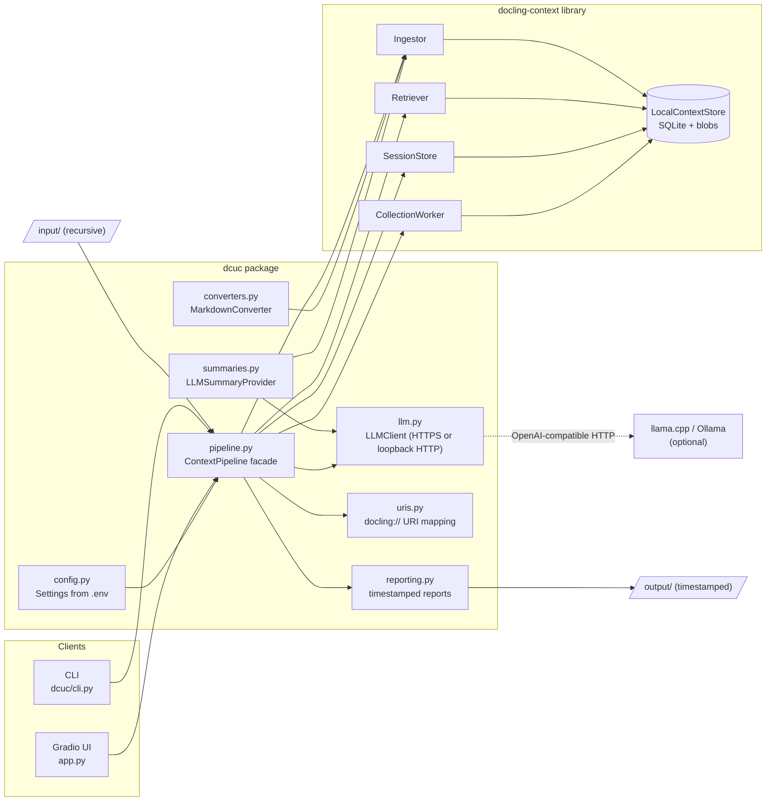
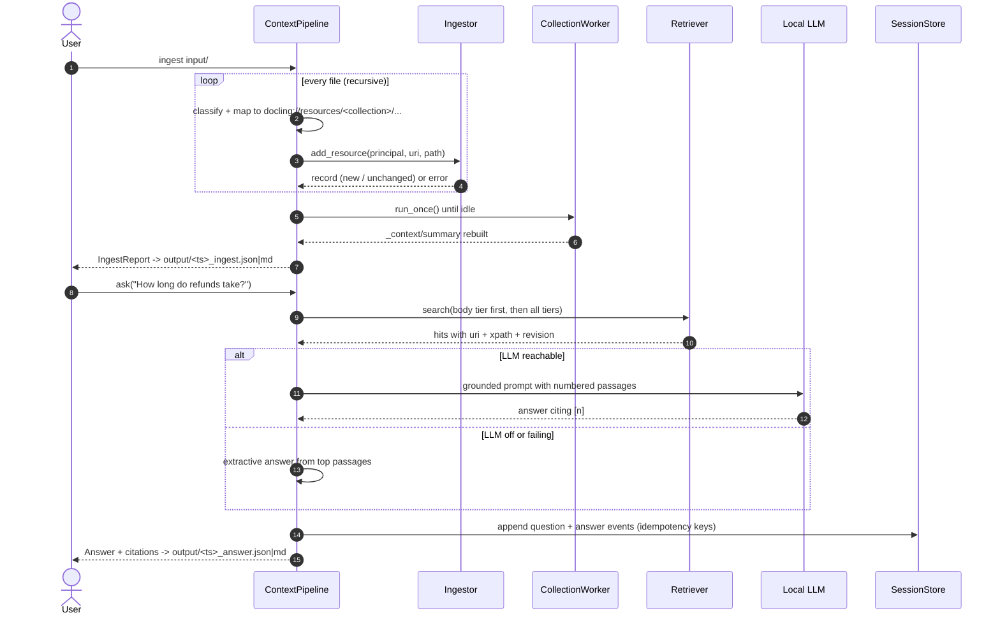

# docling-context sample application (`dcuc`)

A complete, runnable, local-first sample for
[docling-context](https://github.com/docling-project/docling-context). It shows how to
use the library in a realistic application: ingest a folder of documents, keep a
tiered context store (summary, TOC, body), search it with exact citations, answer
questions with a local LLM (with an extractive fallback), and record conversations
in idempotent sessions.

Everything runs on your machine: SQLite storage, a Gradio UI, a CLI, and an optional
OpenAI-compatible local LLM (llama.cpp or Ollama). No cloud services are needed.

---

## Features

| Area | What the sample demonstrates |
|------|------------------------------|
| Initialisation | `LocalContextStore`, `Principal`, `Retriever`, `SessionStore` and `CollectionWorker` wired together in one facade ([`ContextPipeline`](dcuc/pipeline.py:140)), with clean resource handling. |
| Configuration | Typed, validated settings from `.env` ([`Settings`](dcuc/config.py:61)). No hard-coded secrets, and port 5000 is refused on macOS. |
| Ingestion | Recursive ingestion of `input/`, enforced through `allowed_roots`. Native DocLang (`.dclg.xml`) is read directly, a custom `Converter` handles Markdown and text ([`MarkdownConverter`](dcuc/converters.py:123)), and Docling handles PDF and Office files when enabled. |
| Idempotency | Unchanged files are skipped by fingerprint. Each failure is reported per file and the run continues. |
| Summaries | A pluggable `SummaryProvider` backed by the local LLM ([`LLMSummaryProvider`](dcuc/summaries.py:46)). The library falls back to extractive summaries automatically. |
| Collections | `CollectionWorker` processes jobs and builds `_context/summary` for each collection. |
| Search | Lexical search, plus vector and hybrid search when enabled. Supports scopes, tier filters and token budgets. Every hit cites `uri` + `xpath` + `revision`. |
| RAG Q&A | Body-first context selection, a grounded prompt, and numbered citations. Falls back to an extractive answer when the LLM is unavailable. |
| Sessions | `SessionStore.start/append/replay/close`. Each question and answer is appended with its own idempotency key and grouped by `turn_id`. |
| Integration | A CLI (`dcuc ...`), a Gradio web UI (`app.py`), and timestamped JSON and Markdown reports in `output/`. |
| Operations | Consistent console logging (`start.sh` redirects it to `logs/app.log`), detached start and graceful stop scripts, and clean-up scripts. |
| Quality | 83 unit and integration tests (pytest, about 92% coverage) and ruff linting. |

---

## Architecture



A more detailed description, including the data model, tiers and security boundaries, is in [`Docs/Architecture.md`](Docs/Architecture.md).
The end-to-end implementation guide (logging, slugs, LLM routing rules, sessions, uploads, signal handling, validation results) is in [`Docs/Implementation.md`](Docs/Implementation.md).

## Workflow



---

## Project layout and what each section does

```
.
├── app.py                 # Gradio web UI (Status, Ingest, Search, Ask, Explore tabs)
├── dcuc/
│   ├── config.py          # Settings / LLMSettings loaded and validated from the environment
│   ├── logging_setup.py   # Console logging; optional FileHandler (no rotation); logs/app.log comes from start.sh
│   ├── uris.py            # File path -> docling://resources/<collection>/... and file classification
│   ├── converters.py      # Custom Converter: Markdown/text -> DocLang
│   ├── llm.py             # OpenAI-compatible client (HTTPS or loopback HTTP), with bounded responses
│   ├── summaries.py       # SummaryProvider that asks the LLM for document summaries
│   ├── pipeline.py        # ContextPipeline facade: ingest, jobs, tree, search, ask, sessions
│   ├── reporting.py       # Atomic, timestamped JSON + Markdown reports in output/
│   └── cli.py             # `dcuc` command line (ingest, search, ask, tree, show, status, demo)
├── tests/                 # pytest suite (fake LLM via httpx.MockTransport, temp stores)
├── samples/               # Sample corpus (Markdown, text, DocLang, one intentionally broken file)
├── scripts/               # start / stop / demo / test / load-samples / cleanup
├── Docs/                  # Quickstart.md, Architecture.md
├── input/                 # Your documents (processed recursively; contents git-ignored)
├── output/                # Timestamped results (contents git-ignored)
└── context-data/          # docling-context store (SQLite + package blobs)
```

| Module | Responsibility | Key decisions |
|--------|----------------|---------------|
| [`config.py`](dcuc/config.py) | Builds immutable `Settings` from `.env` and the environment. | Strict boolean and integer parsing, so typos fail fast. Port 5000 is rejected. The API key is excluded from `repr`, so it never appears in logs. |
| [`uris.py`](dcuc/uris.py) | Maps `input/a/b.md` to `docling://resources/knowledge/a/b`. | URIs are slugged and deterministic, so re-ingesting a file updates the same resource. A short hash is appended whenever slugging changes a name (for example `support hours.txt` becomes `support-hours-144e0bdf`), which prevents collisions. |
| [`converters.py`](dcuc/converters.py) | Implements the library's `Converter` protocol for `.md` and `.txt`. | Small and dependency-free. Headings become `<heading level>` and paragraphs and list items become `<text>`, so the TOC tier (L1) is meaningful. |
| [`llm.py`](dcuc/llm.py) | Minimal `/chat/completions` client. | Plain HTTP is allowed only for loopback hosts, and anything else must use HTTPS. Timeouts and response size are bounded. Every failure becomes an `LLMError`, so callers can fall back. |
| [`summaries.py`](dcuc/summaries.py) | An LLM-written L0 summary for each document. | If the LLM fails, the library records `summary_method="extractive-fallback"`, so ingestion never breaks. |
| [`pipeline.py`](dcuc/pipeline.py) | The single entry point used by both the CLI and the UI. | A context manager that closes SQLite on exit, including when start-up fails. An `RLock` serialises store access, because the store connection is not thread-safe and Gradio runs handlers on threads. Vector and Docling support are optional and degrade gracefully. |
| [`reporting.py`](dcuc/reporting.py) | Writes `output/YYYYMMDD-HHMMSS_<kind>.json` and `.md`. | Each file is written to a temporary file and then renamed, so partial reports never exist. |
| [`cli.py`](dcuc/cli.py) | Command-line integration. | Exit codes: `0` success, `1` runtime error, `2` configuration error, `130` interrupted. |
| [`app.py`](app.py) | Gradio UI. | Binds to `127.0.0.1` by default. SIGTERM and SIGINT close the pipeline gracefully. |

---

## Quick start

```bash
scripts/load-samples.sh      # copy samples/ into input/ (never overwrites your files)
scripts/demo.sh              # ingest + search + ask from the CLI, with reports in output/
scripts/start.sh             # start the web UI in detached mode and print its URL
scripts/stop.sh              # graceful shutdown
```

For prerequisites and every option, see [`Docs/Quickstart.md`](Docs/Quickstart.md).

### CLI usage

```bash
uv run dcuc ingest [--input DIR] [--force]
uv run dcuc search "credential rotation" -k 5 [--mode auto|lexical|vector|hybrid] [--uri docling://resources/knowledge/policies]
uv run dcuc ask "How long do refunds take?" [--session my-session]
uv run dcuc tree -L 3
uv run dcuc show docling://resources/knowledge/policies/refund-policy
uv run dcuc status
uv run dcuc --no-llm demo
```

### Configuration (`.env`, copied from [`.env.example`](.env.example))

| Variable | Default | Purpose |
|----------|---------|---------|
| `DC_TENANT_ID` / `DC_USER_ID` | `demo` / `local` | The `Principal` that scopes every read and write. |
| `DC_INPUT_DIR` | `./input` | Folder ingested recursively. Also the `allowed_roots` boundary. |
| `DC_OUTPUT_DIR` | `./output` | Timestamped reports. Created if missing. |
| `DC_STORE_DIR` | `./context-data` | Location of the docling-context store. |
| `DC_COLLECTION` | `knowledge` | Collection name, as in `docling://resources/<collection>/...`. |
| `DC_ENABLE_CONVERSION` | `false` | Docling conversion for PDF and Office files (`uv sync --extra conversion`). |
| `DC_ENABLE_VECTORS` | `false` | Vector and hybrid search (`uv sync --extra vectors`). |
| `DC_EMBEDDING_MODEL` | `BAAI/bge-small-en-v1.5` | Embedding model used when vectors are on. |
| `LLM_BASE_URL` | `http://localhost:9931/v1` | OpenAI-compatible local endpoint. Leave empty for extractive-only mode. |
| `LLM_MODEL` / `LLM_API_KEY` | `local-model` / empty | Model name and an optional key. |
| `LLM_TIMEOUT_SECONDS` | `60` | Request timeout. |
| `LLM_SUMMARIES` | `false` | Use the LLM for document summaries during ingestion. |
| `APP_HOST` / `APP_PORT` | `127.0.0.1` / `7860` | Web UI bind address. Port 5000 is refused. |
| `LOG_LEVEL` | `INFO` | Logging level. |

---

## Testing

```bash
scripts/test.sh              # ruff + pytest with coverage
```

The tests use temporary stores, a fake LLM (`httpx.MockTransport`) and the real
docling-context library. Together they cover configuration validation, URI mapping,
conversion, the LLM error paths, ingestion (including idempotency, failures and the
`allowed_roots` boundary), search, RAG fallbacks, sessions, reports, the CLI and the
UI handlers.

## Clean-up

```bash
scripts/cleanup.sh           # stop the app; remove .venv, node_modules, __pycache__, caches, logs
scripts/cleanup.sh --all     # also remove context-data/ and the contents of input/ and output/
```

No container images are pulled by this project, so no image clean-up script is needed.

---

## Licence

This sample is released under the **MIT License**.

Third-party components keep their own licences:
[docling-context](https://github.com/docling-project/docling-context) is MIT, and
[DocLang](https://github.com/doclang-project/doclang) is Apache-2.0. Gradio, httpx
and python-dotenv are Apache-2.0 or BSD.
